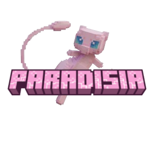

<div align="center">
  
</div>

<h2 align="center">
  Paradisia — Joueurs
</h2>

---

<div align="center">

[](https://forthebadge.com) &nbsp;
[](https://forthebadge.com) &nbsp;
[](https://forthebadge.com) &nbsp;
</div>

---

## À propos

**Paradisia — Joueurs** est le tableau de bord des joueurs du serveur Minecraft **Paradisia** (Cobblemon). Il permet de chercher un joueur, puis d'afficher ses statistiques, son argent et ses Pokémon.

C'est un **site statique léger** : HTML, CSS et JavaScript, sans framework et sans étape de build. Il reprend le thème du site [Portfolio Personal](https://github.com/Rudze/WEB-Portfolio-Personal-main).

Les données viennent de l'API du serveur Minecraft, fournie par le mod `nh_api`. Ce mod est documenté dans le repo [JAVA-MC-MODS-Paradisia](https://github.com/Rudze/JAVA-MC-MODS-Paradisia), dossier `mods/MC-NewHorizon-Mod-Api`.

---

## Fonctionnalités

* ✅ **Recherche** parmi tous les joueurs déjà connectés, avec un point vert pour ceux en ligne
* ✅ **Profil** : tête du joueur, vie, armure, faim, niveau d'expérience, mode de jeu, dimension et armure portée
* ✅ **Économie** : pièces d'or, d'argent et de bronze
* ✅ **Pokédex** : espèces vues et capturées, avec le pourcentage de complétion
* ✅ **Équipe** : les 6 Pokémon du joueur
* ✅ **PC** : on parcourt les boîtes une par une
* ✅ **Détail d'un Pokémon** au clic : nature, talent, objet tenu, Ball, IV, EV et attaques
* ✅ **Statistiques** : temps de jeu, morts, monstres tués, distance parcourue, blocs minés…
* ✅ **Lien direct** vers un joueur : `…/#Rudzee`
* ✅ **Responsive** : ordinateur, tablette et mobile

---

## Structure du projet

```
WEB-MC-Paradisia/
├── index.html                  # Contenu de la page
├── dev-server.py               # Serveur local : sert le site et transmet /api au serveur Minecraft
├── CHANGELOG.md                # Généré par semantic-release
├── .releaserc.json             # Configuration de semantic-release
├── .github/
│   └── workflows/
│       └── release.yml         # Release à chaque push sur main
├── deploy/
│   └── nginx.conf              # Exemple de configuration nginx pour la production
└── assets/
    ├── css/style.css           # Thème (repris du portfolio)
    ├── js/script.js            # Récupère les données de l'API et remplit la page
    └── images/                 # Logo et favicon
```

---

## Comment ça marche

Le site appelle l'API à l'adresse relative `./api`. Le serveur web placé devant le site transmet ces appels à l'API du serveur Minecraft et y **ajoute la clé secrète**. Comme ça, la clé ne part jamais dans le navigateur.

```
navigateur ──> /api/players ──> serveur web (ajoute la clé) ──> nh_api :8091
```

Les images viennent de services publics :
- les têtes des joueurs : [mc-heads.net](https://mc-heads.net) ;
- les sprites des Pokémon : [PokeAPI sprites](https://github.com/PokeAPI/sprites).

---

## Lancer en local

Il faut seulement **Python 3**.

```bash
PARADISIA_API_URL=http://<ip-du-vps>:8091 \
PARADISIA_API_KEY=<token> \
python3 dev-server.py
```

Ouvre ensuite **http://localhost:8000**.

La clé (`token`) se trouve dans `config/nh_api.toml` sur le serveur Minecraft.

---

## Mise en production

La méthode la plus simple est d'utiliser **nginx sur le même VPS** que le serveur Minecraft :

1. Copie les fichiers du site dans `/var/www/paradisia`.
2. Reprends `deploy/nginx.conf` et remplace dedans le nom de domaine et la clé.
3. Dans `config/nh_api.toml`, passe `bindAddress` à `"127.0.0.1"`. L'API n'est alors plus joignable que par nginx.
4. Ajoute HTTPS avec `certbot --nginx -d <domaine>`.

---

## Versionnage

Le projet suit le **versionnage sémantique**, géré automatiquement par [semantic-release](https://semantic-release.gitbook.io).

À chaque push sur `main`, le workflow GitHub Actions :
- lit les messages de commit ;
- calcule la nouvelle version ;
- met à jour `CHANGELOG.md` ;
- crée le tag et la release GitHub.

Les messages de commit suivent les [Conventional Commits](https://www.conventionalcommits.org/fr) :

| Message | Effet sur la version |
|---|---|
| `fix: corrige l'affichage du PC` | patch : `1.0.0` → `1.0.1` |
| `feat: ajoute le classement des joueurs` | mineure : `1.0.0` → `1.1.0` |
| `feat!: …`, ou `BREAKING CHANGE:` dans le corps du commit | majeure : `1.0.0` → `2.0.0` |
| `docs:`, `style:`, `chore:`… | pas de nouvelle version |
